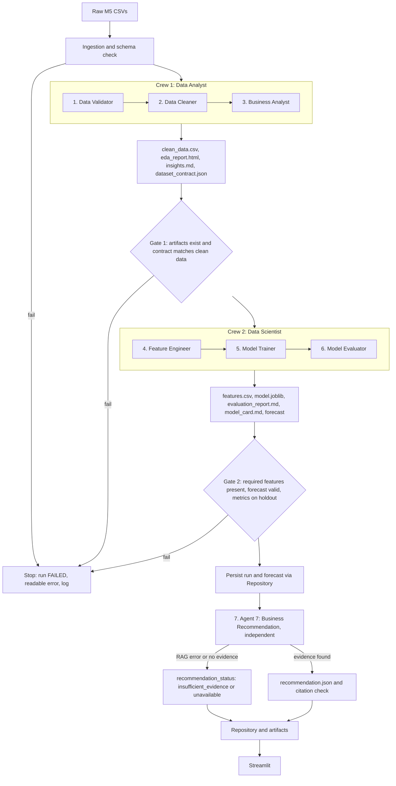
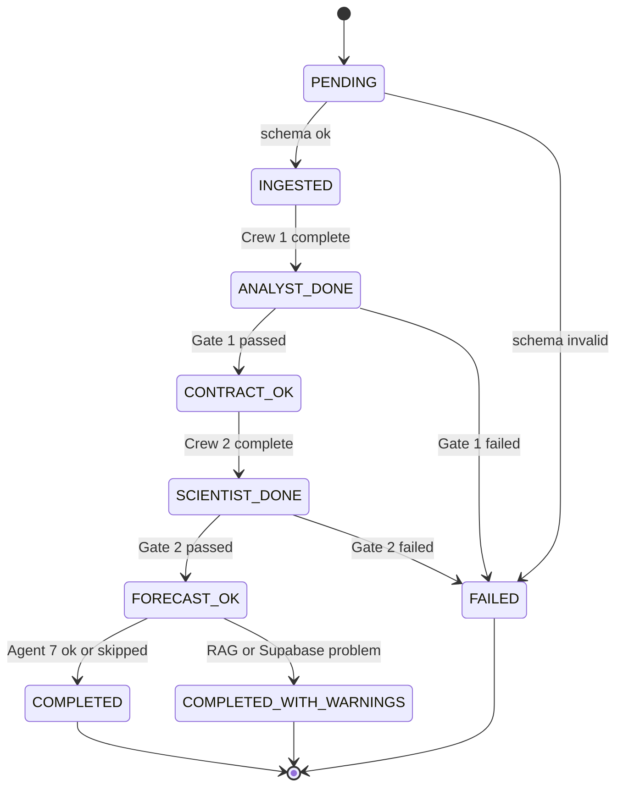
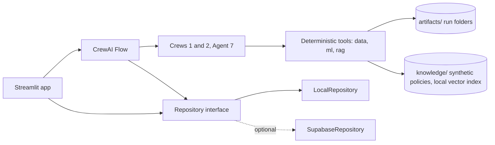

# Architecture

How the system is put together. Requirements: [project-specification.md](project-specification.md). Open choices: [decisions.md](decisions.md). Status of items on this page is given per decision ID.

## Principles

- Deterministic Python tools do all numeric work (ETL, features, training, metrics, citation checks). Agents reason, orchestrate and explain (M-09).
- Exactly two crews of three agents, plus one independent Agent 7 (D-01).
- Agents exchange file paths and small JSON documents, never raw DataFrames through the LLM.
- A failure before the forecast is validated stops the run. A failure after it (RAG, Supabase) never invalidates the forecast (spec s6).
- The app runs end to end without Supabase (D-08).

## End-to-end flow



Agent 7 and the optional Supabase writes are enhancements (O-01, O-02). The mandatory path is everything up to and including Gate 2 and the UI.

## Flow states



Flow state is a typed (Pydantic) object: `run_id`, `status`, artifact paths, metrics, `errors[]`, `recommendation_status`. State names are a proposal; they can change when the Flow is implemented.

## Validation gates

| Gate | Checks | On failure | Maps to |
|---|---|---|---|
| Ingestion | Required files and columns exist, key columns non-null | Stop, readable error, Crew 1 not started | M-19 |
| Gate 1 | The four Crew 1 artifacts exist; `dataset_contract.json` matches `clean_data.csv` (columns, types, allowed values, ranges) | Stop, Crew 2 not started, logged | M-08, M-10 |
| Gate 2 | All required features exist before modeling; model and forecast files exist; forecast covers the 28-day horizon for every selected item; metrics come from the chronological holdout | Stop, logged, no recommendation | M-08, M-16 |
| Agent 7 output check | Schema valid; `forecast_reference` points to this run; every `source_id` exists; quotes are substrings of the source | Status set to `insufficient_evidence` or `unavailable`; forecast kept | O-01 |

Details of the contract and features: [data-and-ml.md](data-and-ml.md). Agent handoff details: [agents-and-tasks.md](agents-and-tasks.md).

## Components



Crews and ML code never call Supabase directly; only the Repository does (spec s10A, D-08).

## Repository layout (Approved, D-21)

```
retailai-multi-agent-sales-intelligence/
  README.md, CLAUDE.md, .gitignore, .env.example
  docs/                      project documentation (this folder), incl. progress.md
  src/
    agents/                  Agent 7 (Business Recommendation) and shared agent definitions
    crews/                   Crew 1 (analyst) and Crew 2 (scientist) agents and tasks
    flows/                   Flow state, gates, orchestration
    data/                    ingestion, wide-to-long ETL, validation, contract
    ml/                      features, models, evaluation, forecast
    rag/                     ingestion, retriever, citation checks
    repositories/            Repository interface, local, supabase
    tools/                   thin typed CrewAI tool wrappers around src/data and src/ml (T-20)
    utils/                   config, logging, shared helpers
  app/                       Streamlit app
  tests/                     unit/, integration/, e2e/
  knowledge/                 synthetic policy documents (Markdown)
  artifacts/                 run outputs (contents git-ignored)
  config/                    non-secret configuration files
```

Local-only, git-ignored: `.env`, `.venv/`, a root `data/` folder for downloaded M5 files, vector indexes, logs. CrewAI tool wrappers live in `src/tools/` (T-20, approved 2026-11-23); where Supabase SQL migrations live is still open. Code is imported as `src.<package>` from the repository root (pytest `pythonpath = ["."]`).

| Directory | Responsibility |
|---|---|
| `src/data/` | Load M5 files, reshape to long form, validate, write the contract |
| `src/ml/` | Features, Seasonal Naive, Ridge, Random Forest, MAE/RMSE, forecasts |
| `src/crews/`, `src/agents/` | Agent, task and crew definitions only; no business logic |
| `src/tools/` | Thin typed CrewAI tools: call the tested logic, take file paths, return short JSON summaries (no data rows to the LLM, T-04) |
| `src/flows/` | State model, gates, orchestration, logging of transitions |
| `src/rag/` | Document ingestion, retrieval, citation verification |
| `src/repositories/` | Storage interface and its two implementations; `run_artifacts.py` is the read-only reader of `artifacts/runs/<run_id>/` used by the Streamlit pages (lists runs, loads reports and texts, reports missing files, never reads `clean_data.csv`) |
| `src/utils/`, `config/` | Config loading, logging setup, non-secret settings |
| `app/` | Streamlit pages; reads artifacts and the Repository |
| `tests/` | Unit, integration, end-to-end |

## Streamlit screens (M-13, M-23, O-06)

| Screen | Purpose | Reads from |
|---|---|---|
| Home / Pipeline Execution | Choose dataset/config, start a run, show status | Flow state |
| Data Quality | Quality report, cleaning log, contract | Crew 1 artifacts |
| Exploratory Data Analysis | Show `eda_report.html` | Crew 1 artifacts |
| Business Insights | `insights.md`, trends by department/category | Crew 1 artifacts |
| Sales Forecasting | Pick an item, history plus 28-day forecast | Forecast table |
| Model Evaluation | MAE/RMSE per model and per item, model comparison | Evaluation outputs |
| Business Recommendations (optional) | Recommendation, evidence, limits, abstention status | `recommendation.json` |
| Run History and Logs | Run status, errors, artifact links | Repository, logs |

The spec lists five core screens; EDA, Model Evaluation and Recommendations are split out here for clarity (Proposed). Pages only read results; only Home starts a run. Streamlit is approved (D-12); until the Flow exists, Home shows the run command instead of a run button.

## LLM provider and cost controls (T-01)

Claude Code is used only to develop the project. At runtime all seven agents call the **OpenAI API**. The provider, models and limits are read from environment variables (see `.env.example`); no key, model name or limit is hard-coded.

| Setting | Value | Status |
|---|---|---|
| Default model (`OPENAI_MODEL`) | `gpt-4.1-mini`: low cost, reliable tool calling and structured outputs, no hidden reasoning tokens, so cost and latency are predictable | Verified (T-01) |
| Fallback (`OPENAI_FALLBACK_MODEL`) | `gpt-4o-mini`: use if the default has compatibility or quality problems | Proposed |
| Escalation | `gpt-4.1` only for a specific agent whose output quality is not acceptable | Proposed |
| Not chosen by default | GPT-5 family (`gpt-5-mini`, `gpt-5-nano`): reasoning models, more tokens and variable cost | Proposed |

**Verification status:** verified 2026-11-23. First real run 2026-11-23 (approved): model check passed (`gpt-4.1-mini`, 15 tokens); Crew 1 run `20261123-175149-8df956` completed in 2.5 minutes with 12 LLM calls and 89,793 provider-reported tokens (about 45% of the 200,000 cap); Agent 3 uses most tokens because the 78 EDA facts are resent with each of its calls. Caps kept at 100 calls and 200,000 tokens per run. A monthly spend limit is set on the OpenAI project (amount kept by the developers).

**Cost controls**

| Control | Rule |
|---|---|
| Deterministic first | ETL, features, training, metrics, citation checks and validation are plain Python; agents only choose tools and write explanations |
| Temperature | 0 for all agents (`LLM_TEMPERATURE`) |
| Retries | At most 2 retries with backoff (`LLM_MAX_RETRIES`); a failed call is logged, never looped |
| Agent limits | Small maximum iterations per agent; a request timeout (`LLM_TIMEOUT_SECONDS`) and an output token limit (`LLM_MAX_OUTPUT_TOKENS`) |
| Per-run caps | A call cap and a token cap per Flow run (`LLM_MAX_CALLS_PER_RUN`, `LLM_MAX_TOKENS_PER_RUN`); hitting a cap stops the LLM stage with a clear error (before Gate 2 the run fails; after it, the run completes with warnings). Starting values are guesses and are tuned after the first real run. **Implemented** in `src/utils/llm_budget.py` with CrewAI's `before_llm_call` hook: once a cap is reached the next call is blocked before it reaches OpenAI, and the run fails with the reason in its report. Tokens are the provider-reported counts; the check runs before each call, so the last call can pass the token cap by at most one call. Every LLM call during a run counts (fail safe) |
| Token monitoring | Token usage per agent and per run is logged and stored in the run manifest. The numbers come from the budget hook (`llm_budget` in `crew1_report.json`); CrewAI's crew-level token_usage is not used, because with one LLM shared by the agents it adds the same usage once per agent (3x in the first run). CrewAI also sends preflight requests to OpenAI's input-token count endpoint before some calls (19 in the first run); they carry the same prompts and are not counted as LLM calls |
| Spend limit | A monthly budget limit and alert on the OpenAI project; each developer uses their own API key. Amount: pending (T-01) |
| Tests | Automated tests mock the LLM, so they cost nothing and are repeatable; real-LLM runs happen only at phase gates and for the demo |
| Telemetry | CrewAI telemetry and tracing are always turned off in code (`CREWAI_DISABLE_TELEMETRY`, `OTEL_SDK_DISABLED`, `CREWAI_TRACING_ENABLED=false`); only OpenAI calls leave the machine. Crew tests use a scripted fake LLM and fail on any non-local network connection |
| Secrets | Keys live only in a local `.env`; they are never printed, logged or committed. Settings hold the key in a `Secret` that never shows its value. CrewAI `LLM` objects include the API key in their repr, so LLM objects must never be printed or logged; as a safety net, every log line is redacted (`sk-...` patterns and known secret values) by `src/utils/logging_setup.py` |

**Two separate costs:** the Claude Code subscription pays for development help (writing code and docs). The OpenAI API is pay-per-token and is billed to the OpenAI account; only running the pipeline's agents (and optional embeddings for RAG, T-21) uses it. They are billed independently.

## Configuration, logging, reproducibility

- Configuration comes from environment variables and a small config module (`src/utils/`, `config/` for non-secret settings; the store id is a setting, T-02); `.env` is never committed, `.env.example` lists the keys (M-21). Backend choice: `REPOSITORY_BACKEND=local|supabase` (default `local`).
- One `run_id` per Flow run, reused on retry; each run writes to its own artifact folder with a log file and a run manifest (seeds, library versions, split boundaries, dataset version) (M-09, M-20).
- Run folder: `artifacts/runs/<run_id>/` (approved 2026-11-23); Crew 1 and later the Flow write every artifact of a run there (git-ignored).
- Implementation: `src/utils/config.py` (`load_settings`, `load_llm_settings`; only `REPOSITORY_BACKEND=local` and `LOG_LEVEL=INFO` have defaults, the OpenAI key, model and every limit must be set), `src/utils/llm.py` (`build_llm`, the only place an LLM is created), `src/utils/logging_setup.py` (redacting log setup used by every command-line entry point).
- Logging redacts secrets; every state transition and gate result is logged.
