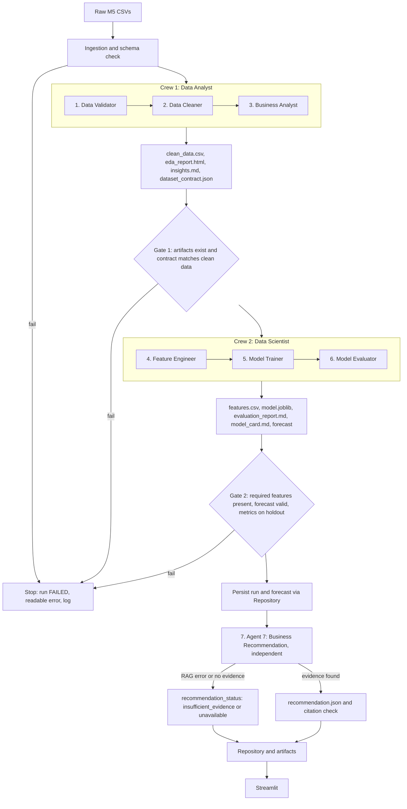
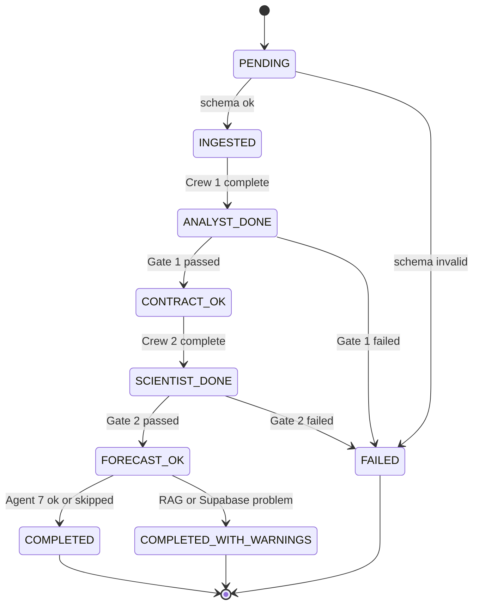
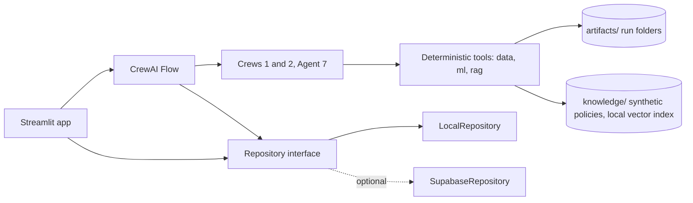

# Architecture

How the system is put together. Requirements: [project-specification.md](project-specification.md). Open choices: [decisions.md](decisions.md). Status of items on this page is given per decision ID.

## Principles

- Deterministic Python tools do all numeric work (ETL, features, training, metrics, citation checks). Agents reason, orchestrate and explain (M-09).
- Exactly two crews of three agents, plus one independent Agent 7 (D-01).
- Agents exchange file paths and small JSON documents, never raw DataFrames through the LLM.
- A failure before the forecast is validated stops the run. A failure after it (RAG, Supabase) never invalidates the forecast (spec s6).
- The app runs end to end without Supabase (D-08).

## End-to-end flow



Agent 7 and the optional Supabase writes are enhancements (O-01, O-02). The mandatory path is everything up to and including Gate 2 and the UI.

## Flow states



Flow state is a typed (Pydantic) object: `run_id`, `status`, artifact paths, metrics, `errors[]`, `recommendation_status`. State names are a proposal; they can change when the Flow is implemented.

## Validation gates

| Gate | Checks | On failure | Maps to |
|---|---|---|---|
| Ingestion | Required files and columns exist, key columns non-null | Stop, readable error, Crew 1 not started | M-19 |
| Gate 1 | The four Crew 1 artifacts exist; `dataset_contract.json` matches `clean_data.csv` (columns, types, allowed values, ranges) | Stop, Crew 2 not started, logged | M-08, M-10 |
| Gate 2 | All required features exist before modeling; model and forecast files exist; forecast covers the 28-day horizon for every selected item; metrics come from the chronological holdout | Stop, logged, no recommendation | M-08, M-16 |
| Agent 7 output check | Schema valid; `forecast_reference` points to this run; every `source_id` exists; quotes are substrings of the source | Status set to `insufficient_evidence` or `unavailable`; forecast kept | O-01 |

Details of the contract and features: [data-and-ml.md](data-and-ml.md). Agent handoff details: [agents-and-tasks.md](agents-and-tasks.md).

## Components



Crews and ML code never call Supabase directly; only the Repository does (spec s10A, D-08).

## Repository layout (Approved, D-21)

```
retailai-multi-agent-sales-intelligence/
  README.md, CLAUDE.md, .gitignore, .env.example
  docs/                      project documentation (this folder), incl. progress.md
  src/
    agents/                  Agent 7 (Business Recommendation) and shared agent definitions
    crews/                   Crew 1 (analyst) and Crew 2 (scientist) agents and tasks
    flows/                   Flow state, gates, orchestration
    data/                    ingestion, wide-to-long ETL, validation, contract
    ml/                      features, models, evaluation, forecast
    rag/                     ingestion, retriever, citation checks
    repositories/            Repository interface, local, supabase
    utils/                   config, logging, shared helpers
  app/                       Streamlit app
  tests/                     unit/, integration/, e2e/
  knowledge/                 synthetic policy documents (Markdown)
  artifacts/                 run outputs (contents git-ignored)
  config/                    non-secret configuration files
```

Local-only, git-ignored: `.env`, `.venv/`, a root `data/` folder for downloaded M5 files, vector indexes, logs. Where CrewAI tool wrappers and Supabase SQL migrations live is TBD (T-20); the Python package layout under `src/` (package name, imports) is decided when code starts.

| Directory | Responsibility |
|---|---|
| `src/data/` | Load M5 files, reshape to long form, validate, write the contract |
| `src/ml/` | Features, Seasonal Naive, Ridge, Random Forest, MAE/RMSE, forecasts |
| `src/crews/`, `src/agents/` | Agent, task and crew definitions only; no business logic |
| `src/flows/` | State model, gates, orchestration, logging of transitions |
| `src/rag/` | Document ingestion, retrieval, citation verification |
| `src/repositories/` | Storage interface and its two implementations |
| `src/utils/`, `config/` | Config loading, logging setup, non-secret settings |
| `app/` | Streamlit pages; reads artifacts and the Repository |
| `tests/` | Unit, integration, end-to-end |

## Streamlit screens (M-13, M-23, O-06)

| Screen | Purpose | Reads from |
|---|---|---|
| Home / Pipeline Execution | Choose dataset/config, start a run, show status | Flow state |
| Data Quality | Quality report, cleaning log, contract | Crew 1 artifacts |
| Exploratory Data Analysis | Show `eda_report.html` | Crew 1 artifacts |
| Business Insights | `insights.md`, trends by department/category | Crew 1 artifacts |
| Sales Forecasting | Pick an item, history plus 28-day forecast | Forecast table |
| Model Evaluation | MAE/RMSE per model and per item, model comparison | Evaluation outputs |
| Business Recommendations (optional) | Recommendation, evidence, limits, abstention status | `recommendation.json` |
| Run History and Logs | Run status, errors, artifact links | Repository, logs |

The spec lists five core screens; EDA, Model Evaluation and Recommendations are split out here for clarity (Proposed). Pages only read results; only Home starts a run. Streamlit is Proposed (D-12).

## Configuration, logging, reproducibility

- Configuration comes from environment variables and a small config module; `.env` is never committed, `.env.example` lists the keys (M-21). Backend choice: `REPOSITORY_BACKEND=local|supabase` (default `local`).
- One `run_id` per Flow run, reused on retry; each run writes to its own artifact folder with a log file and a run manifest (seeds, library versions, split boundaries, dataset version) (M-09, M-20).
- Logging redacts secrets; every state transition and gate result is logged.
