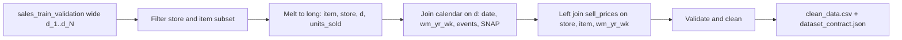

# Data and Machine Learning

Dataset handling and forecasting approach. Requirements: M-16 to M-18, M-20, M-24 in [project-specification.md](project-specification.md). Items marked **Proposed** are not yet confirmed ([decisions.md](decisions.md)).

## Dataset: M5 Forecasting - Accuracy (Walmart) (D-02)

| File | Content | Use |
|---|---|---|
| `sales_train_validation.csv` | Daily unit sales per item/store in wide columns `d_1`, `d_2`, ... | Target `units_sold` |
| `calendar.csv` | Date for each `d`, `wm_yr_wk`, events, SNAP flags | Date mapping, known future features |
| `sell_prices.csv` | Weekly price per `store_id`, `item_id`, `wm_yr_wk` | Price analysis (EDA) |

Data is downloaded manually from Kaggle, and only **after each developer has accepted the competition rules on their own Kaggle account (T-04, Approved with conditions)**. Raw and processed data are git-ignored and never committed; the repository holds only download instructions. Redistribution is not assumed to be allowed, so test fixtures are synthetic (M5-shaped), never real M5 rows.

**Terms check and download steps (T-04)**
1. Log in to Kaggle, open the *M5 Forecasting - Accuracy* competition, and read its **Rules** and **Data** pages (including the data license and any "accept rules" step).
2. Confirm that educational / coursework use is allowed and note any limit on redistribution or on publishing results.
3. Record the outcome in this section: date, who checked, link, conclusion. Until that is recorded, nobody downloads or uses the data.
4. Download the three files through the Kaggle website (or the Kaggle CLI with a personal token kept outside the repo; installing the CLI needs approval) and place them in a root `data/raw/` folder, which Git ignores.
5. Record the dataset version/date in `dataset_contract.json` and the run manifest.

**Terms check result (T-04):** checked 2026-11-18 by Lilach Afik on the competition Rules page, section 7 "Competition Data" (the Data tab license says "Subject to Competition Rules"). Rule 7A allows non-commercial use for academic research and education. Rule 7B forbids passing the data to anyone who has not accepted the rules. Conclusion: **allowed, with conditions**: (1) each developer accepts the rules on their own Kaggle account and downloads their own copy; (2) no M5 data in the public repository: no raw files and no row-level copies such as `clean_data.csv`; (3) anyone else who runs the project (for example graders) downloads the data from Kaggle themselves; (4) slides, demo and dashboard show aggregates, charts, metrics and forecasts only, with no raw data tables or data downloads; a public deployment (D-17) needs a fresh check; (5) if Supabase ever holds M5-derived rows, the project stays private to the two developers; (6) LLM agents receive summaries, statistics and metrics, not bulk raw rows. The download contains `calendar.csv`, `sales_train_validation.csv` (d_1 to d_1913), `sales_train_evaluation.csv` (d_1 to d_1941), `sell_prices.csv` and `sample_submission.csv`, about 450 MB in total; which sales file we use is decided during the inspection (T-09).

The dataset has no promotion, coupon or discount-percentage field; price changes are not treated as promotions.

Fields not guaranteed to exist must not be assumed: the first pipeline step is a read-only inspection of the real files (shape, date range, missing dates, price coverage, zero rate per item).

## Scope (M-18)

- One store: **`CA_1`** (T-02, Approved). The store id is a configuration value, so another store can be selected later; the MVP implements one store only.
- Items: **20** (T-03, Approved 2026-11-23), with the option to expand to 50 using the same method.
- Intermittent items are a documented limitation.

### Item selection method (T-03)

| Rule | Detail |
|---|---|
| Data used | Training period only (d_1 to d_1885, T-09). The validation window and the final 28-day test window are never used to pick items |
| Pool | All items sold in `CA_1` |
| Eligibility | History of at least **365 days**, at most **80%** zero-sales days, price coverage of at least **95%** (definitions below) |
| Demand levels | Rank eligible items by mean daily units (ties broken by `item_id`) and cut the ranking into three equal-size groups: high, medium, low. Take 7/7/6 for 20 items |
| Choice within a level | **Deterministic stratified spread**, no randomness: sort the group by mean daily units, cut it into as many equal slices as items needed, and take the middle item of each slice (`spread_positions` in `src/data/inspect_m5.py`). The picks cover the group's demand range. No random seed is used |
| Record | Method, thresholds and selected `item_id` values go into `dataset_contract.json` (`selection` block) and into the list below |
| Expansion | Going from 20 to 50 repeats the same method with a larger count (17/17/16) |

**Definitions (all on days 1 to 1885 only)**

- **First observed sale:** the first training day with `units_sold > 0`. M5 items show zeros before they were stocked, so the zeros before the first sale are treated as "not yet available", not as zero demand.
- **History length:** the number of days from the first observed sale through d_1885, inclusive. Items never sold in training have a history of 0 and are not eligible.
- **Mean daily units and zero-sales share:** computed over the same days (from the first sale onward).
- **Price coverage:** the share of training weeks (`wm_yr_wk`), from the week of the first sale through the last training week, that have a `sell_price` for the item in `CA_1`. Prices are expected to be missing before an item becomes available, so those weeks are not counted. Inspection result: every `CA_1` item has a price in 100% of its weeks after first sale, no item's prices start after its first-sale week, and no item lacks prices in training, so missing prices only occur before availability (input for T-13).

**Inspection result (2026-11-23):** 3,049 items in `CA_1`; 23 excluded for short history, 501 as too sparse, 0 for price coverage; 2,528 eligible (843 high, 842 medium, 843 low), so every group has far more items than it needs. Demand ranges: high 1.38 to 66.7 units/day, medium 0.66 to 1.38, low 0.23 to 0.66.

**Selected `item_id` values (T-03, Approved):**

| Group | Items (mean daily units in training) |
|---|---|
| High (7) | `FOODS_3_234` (9.29), `FOODS_1_162` (4.95), `HOUSEHOLD_1_494` (3.47), `FOODS_3_208` (2.51), `HOUSEHOLD_1_180` (2.00), `FOODS_3_190` (1.68), `FOODS_3_433` (1.47) |
| Medium (7) | `FOODS_2_189` (1.30), `FOODS_3_060` (1.17), `FOODS_2_107` (1.06), `HOUSEHOLD_1_299` (0.94), `FOODS_3_488` (0.85), `HOUSEHOLD_1_091` (0.77), `FOODS_1_015` (0.69) |
| Low (6) | `HOUSEHOLD_2_219` (0.62), `FOODS_3_427` (0.55), `FOODS_2_007` (0.48), `FOODS_2_179` (0.41), `HOUSEHOLD_2_003` (0.35), `HOBBIES_1_002` (0.28) |

Reproduce with `uv run python -m src.data.inspect_m5 --store-id CA_1` (writes `artifacts/inspection/`, git-ignored). Note: price coverage is used for selection and EDA even though `sell_price` is not a model feature (D-07), because the optional promotions analysis (O-03) and a possible price variant need it.

## ETL: wide to long



Normalized fields (spec s5): `date, store_id, item_id, dept_id, cat_id, state_id, units_sold, sell_price, wm_yr_wk, event_name_1, event_type_1`, SNAP indicator. Missing prices are examined and handled per the null policy below (T-13), never silently imputed. Field validation rules are in the table in [project-specification.md](project-specification.md) (section 5).

## Dataset contract (M-24, T-12 Approved)

`dataset_contract.json` is a **versioned JSON file** written by the Business Analyst (Crew 1) and read by Gate 1, Crew 2 and the Flow. It describes the dataset so that data can be checked mechanically.

| Section | Content |
|---|---|
| `schema_version` | Contract version (for example `1.0.0`); changed whenever the structure changes |
| `dataset` | Name, source, files, download date, whether the terms check (T-04) was done |
| `granularity` | Keys `store_id`, `item_id`, `date`; daily frequency; one row per key combination |
| `selection` | Store, selected `item_id` list, selection method and thresholds (see above; no seed, the method is deterministic) |
| `fields` | For each field: name, type, nullable, allowed range or allowed values |
| `missing_value_rules` | What is allowed to be missing and how it is handled (for example prices, T-13) |
| `quality_expectations` | Limits such as maximum share of missing values, no duplicate keys, no gaps in dates |
| `validation_rules` | Named checks the validator runs (for example `units_sold >= 0`, `sell_price > 0 when present`) |
| `assumptions`, `limitations` | Plain-language lists (for example "no promotion flag in M5") |

Validation is **deterministic Python** (plain pandas checks, one function per rule, readable error messages) in `src/data/`. No schema-management framework is added. Gate 1 and the Feature Engineer both run it; a failure stops the Flow (M-08, M-19). The exact field list is finalized when the first clean data exists.

**Implementation (P-06):** `src/data/contract.py`. `uv run python -m src.data.contract` reads `artifacts/clean/clean_data.csv` and `cleaning_log.json`, writes `dataset_contract.json` and checks the data against it (`contract_check.json`). Allowed values for store, items, departments, categories and state come from the approved scope, not from the data, so the check is not circular; event types and the week range are taken from the clean data. The `dataset` section records the size and SHA-256 checksum of each raw file used, so the exact data version is known even though each developer downloads separately (T-04). The Gate 1 check runs nine rules: `columns_match`, `field_types`, `no_unexpected_nulls`, `allowed_values`, `value_ranges`, `unique_keys`, `dates_continuous_per_item`, `no_future_dates`, `sorted_by_item_and_date`. The contract holds no data rows.

## EDA and insights (P-05)

Implemented in `src/data/eda.py`; `uv run python -m src.data.eda` reads `artifacts/clean/clean_data.csv` and writes `eda_summary.json`, `eda_report.html` and `insights.md` to `artifacts/eda/` (git-ignored).

| Rule | Detail |
|---|---|
| Period | Training period only (d_1 to d_1885, T-09); validation and test never influence EDA findings |
| Normalization | Categories and demand groups are compared by average daily units per item (per item-day), with totals shown separately |
| Closures | Days with `store_closed = 1` are excluded from pattern averages |
| Associations | SNAP, event-day and price findings are descriptive associations, not causal effects; price changes are not promotions |
| Traceability | Every statistic is a numbered fact (F01, F02, ...) with value, unit and definition in `eda_summary.json`; `insights.md` cites fact ids, and a test checks that every number in it matches a fact. Agent 3 (P-04) may rewrite the insights only from these facts |
| Report | `eda_report.html` is self-contained (8 embedded charts, aggregate tables only, no data rows), so it is safe for the demo (T-04) |

Real data highlights (training period): 1.82 units per item per day overall; high, medium and low demand groups average 3.93, 0.96 and 0.44; Sunday is the busiest weekday; SNAP days show 22.7% higher average units (FOODS 29.0%), an association only.

## Forecast target (D-03)

Daily `units_sold` for the next 28 days, per `item_id` x `store_id`. Two separate forecasts are produced (T-22, Approved 2026-11-26):

| Forecast | Days | Origin | Purpose | File |
|---|---|---|---|---|
| Test forecast | d_1914 to d_1941 (2016-04-25 to 2016-05-22) | d_1913 | Final evaluation only; actuals are known | `test_forecast.csv` |
| Future forecast | d_1942 to d_1969 (2016-05-23 to 2016-06-19) | d_1941 | Streamlit dashboard and Agent 7; no actuals exist | `forecast.csv` |

Evaluation metrics go to `metrics.json`. After the test evaluation, the selected model type is refitted on all history through d_1941 with the same hyperparameters to produce the future forecast (T-16); the test metrics stay unchanged. Calendar features for the future days come from `calendar.csv`, which runs to d_1969, so no new data file is needed. Events in that window are Memorial Day, the NBA Finals start and end, and Ramadan starts; there is no 25 December, so `store_closed` is 0.

## Cleaning (T-13, Approved)

Implemented in `src/data/cleaning.py`; `uv run python -m src.data.cleaning` runs validation, ETL and cleaning and writes `clean_data.csv`, `cleaning_log.json` and `quality_report.json` to `artifacts/clean/` (git-ignored; `clean_data.csv` is row-level M5 data and is never committed, T-04).

| Rule | Detail |
|---|---|
| Rows before first sale | Dropped. The first sale is the first training day (d_1 to d_1885) with `units_sold > 0`; validation and test data never set it. Each item's series then runs without gaps to d_1941 |
| Store closures | `store_closed = 1` on 25 December, otherwise 0; `units_sold` stays 0. The validator found the store sold nothing on exactly these days in all five years. A known calendar date, so it is available at forecast time |
| Missing prices | Never imputed. A missing or non-positive `sell_price` on a kept row fails the cleaning. In `CA_1`, prices start on or before each item's first sale, so after rule 1 no price is missing |
| Final checks | Unique keys, `units_sold >= 0`, no date gaps per item, sorted by `item_id`, `date` |

Result on the real data: 38,820 long rows become 31,278 clean rows; 7,542 pre-launch rows dropped (17 of 20 items; first sales from 2011-01-29 to 2014-02-09); 85 closure rows flagged; 0 missing prices.

## Chronological split (M-17)

```
|-------- train --------|-- validation (28d) --|-- test holdout (28d) --|
 d_1                                                          last day
```

| Part | Days | Dates |
|---|---|---|
| Train | d_1 to d_1885 | 2011-01-29 to 2016-03-27 |
| Validation | d_1886 to d_1913 | 2016-03-28 to 2016-04-24 |
| Test | d_1914 to d_1941 | 2016-04-25 to 2016-05-22 |

Approved 2026-11-23 (T-09). Source file: `sales_train_evaluation.csv` (d_1 to d_1941); `sales_train_validation.csv` is an exact prefix of it, so it is not needed.

- Chronological splitting only; no random shuffling.
- The test period is excluded from model selection, hyperparameter tuning, product selection and feature engineering decisions. It is used once, for the final evaluation.
- Models are compared and tuned on rolling-origin backtest windows (below), not on the test window. After model selection, the test-forecast model is fitted on train plus validation (d_1 to d_1913), see T-16.

### Rolling-origin backtest (T-23, Approved)

For model comparison and hyperparameter tuning only. Three chronological, non-overlapping windows, each a 28-day forecast from its own origin (the last observed day):

| Window | Origin | Forecast days | Dates | Fit on |
|---|---|---|---|---|
| 1 | d_1829 (2016-01-31) | d_1830 to d_1857 | 2016-02-01 to 2016-02-28 | d_1 to d_1829 |
| 2 | d_1857 (2016-02-28) | d_1858 to d_1885 | 2016-02-29 to 2016-03-27 | d_1 to d_1857 |
| 3 | d_1885 (2016-03-27) | d_1886 to d_1913 | 2016-03-28 to 2016-04-24 | d_1 to d_1885 |

Window 3 is the validation window of T-09. At every origin, preprocessing, feature generation and fitting use only data up to that origin; nothing from the forecast window or later may influence them. Scores are compared per window and averaged. Windows 1 and 2 lie inside T-09's training period, which is fine for a backtest because each fit stops at its own origin. The test window (d_1914 to d_1941) is never part of the backtest. The window count can grow later; any change to these dates is recorded here and in `decisions.md` before it is used.

## Features (M-16, spec s8)

| Group | Features | Available at forecast time? |
|---|---|---|
| Calendar | Day of week, month, day of month | Yes |
| Events / SNAP | `event_name_1`, `event_type_1`, SNAP flag | Yes (calendar is known in advance) |
| Lags | Sales lags | Only lags at least as old as the horizon step |
| Rolling | Mean/std of past sales, past-only | Only windows ending before the forecast origin |
| Price | `sell_price` | No. Future prices are unknown (D-07) |

### Implemented feature set (P-07)

Defined once in `src/ml/feature_spec.py`; the Feature Engineer, Gate 2 and the Model Trainer all read it (no separate manifest file, since the set is fixed). For target day t, with sales available only up to t - 28:

| Group | Features |
|---|---|
| Lags (same weekday) | `lag_28`, `lag_35`, `lag_42` |
| Rolling, ending at t - 28 | `roll_mean_7` (days t-34 to t-28), `roll_mean_28` and `roll_std_28` (days t-55 to t-28) |
| Calendar | `day_of_week`, `month`, `day_of_month` |
| Known in advance | `event_type_1` (`none` when empty), `snap` (the store's state), `store_closed` (25 December rule, T-13) |
| Descriptors | `item_id`, `dept_id`, `cat_id` (categorical) |

One global model per variant covers all 20 items. `features.csv` also holds the keys (`store_id`, `item_id`, `date`), the metadata `day` and `demand_group`, and the target `units_sold` (empty for d_1942 to d_1969). Notes:

- **`demand_group` is metadata, not a feature.** T-03 assigns the groups from d_1 to d_1885, which overlaps the first two backtest windows, so using the label as a model input could leak. It is used only to report scores.
- **`store_closed` for future days** follows the date rule (25 December); no future day in d_1942 to d_1969 falls on it. Event and SNAP values for all days come from `calendar.csv` (T-22).
- **Missing history is never imputed.** A feature whose look-back reaches before an item's first sale is empty, and `training_rows` leaves those days out. A gap, a missing value or a negative value inside an item's history stops the build. Every forecast-window day has complete features (every item has at least 722 days of history).
- **Leakage checks:** `check_spec` rejects any look-back shorter than the horizon; tests change sales after t - 28, after an origin or for another item and confirm the features, training rows and forecast rows do not change.
- `features.csv` holds the test-period actuals as the target (local only, git-ignored, T-04).

### Multi-step strategy (D-06, Approved)

A 28-day horizon means a 7-day lag is unknown for days 8-28. Approved approach: **direct forecasting with horizon-safe features.** Use only lags and rolling windows computed from data at least 28 days before each target date (for example lag 28, 35, 42 and rolling statistics shifted by 28), plus calendar and SNAP features. One model per variant, no recursive error accumulation, and every feature is available when the forecast is made. A recursive variant (7/14-day lags with predicted values fed back) is not planned.

### Price handling and future covariates (D-07, Approved; T-22)

The MVP model does not use `sell_price`: future weekly prices are not known at the forecast origin, and `sell_prices.csv` ends at the last observed week. Price is analyzed descriptively in EDA. If a price variant is added later, it must hold the last price observed at the origin constant for the whole horizon and state that assumption.

Covariates for any forecast day, test or future, may only be information available at the forecast origin:

| Covariate | Source for forecast days | Allowed |
|---|---|---|
| Day of week, month, day of month | Derived from the date | Yes |
| `event_name_1`, `event_type_1`, SNAP flag for `CA_1` | `calendar.csv` (published in advance, through d_1969) | Yes |
| `store_closed` | Fixed calendar rule: 25 December | Yes |
| Lags and rolling statistics | Computed from sales at least 28 days before the target day, so at or before the origin | Yes |
| `sell_price` | Not available beyond the origin | No (D-07) |
| Actual sales inside the forecast window | Unknown by definition | Never |

## Leakage prevention (M-17)

- A feature for date `t` uses only information available at the forecast origin (data at least 28 days before `t` under D-06). The forecast origin is the last day before the forecast window: d_1829, d_1857 and d_1885 for the three backtest windows, d_1913 for the test forecast and d_1941 for the future forecast.
- Lags, rolling statistics and covariates are checked against the full 28-day horizon: no feature for any of the 28 days may use actual sales from inside the forecast window. Only covariates known in advance (calendar, events, SNAP) are used for future days.
- Rolling features exclude the target day.
- Test observations are never used for fitting, feature selection or tuning.
- Unknown future prices are not assumed.
- Automated tests enforce these rules: see [testing-strategy.md](testing-strategy.md).

## Models and evaluation (D-04, D-05)

| Model | Role |
|---|---|
| Seasonal Naive | Baseline (T-23): the last seven observed daily values before the forecast origin, repeated four times for 28 days |
| Ridge Regression | Variant 1 (D-05, Approved) |
| Random Forest Regressor | Variant 2 (D-05, Approved) |

- Evaluation covers the complete 28-day horizon from one forecast origin per window: all 28 days are predicted without using actual sales from inside the window (no one-day-ahead evaluation with true lags). The backtest windows pick models and hyperparameters; the final metrics come from the test window, evaluated once.
- The Seasonal Naive baseline and at least two ML model variations are compared on MAE and RMSE (D-04).
- Metrics are reported in aggregate and per product, and also per demand group (high, medium, low), so differences between groups are visible. Seeds fixed.
- MAPE is avoided because intermittent items contain many zeros.
- Hyperparameters are tuned on the backtest windows only (T-23). The test-forecast model is fitted on train plus validation, and the future-forecast model on all history through d_1941 with the same hyperparameters (T-16).
- Outputs: `features.csv`, `model.joblib`, `test_forecast.csv`, `forecast.csv`, `metrics.json`, `evaluation_report.md`, `model_card.md` (M-04, M-06).

**Baseline implementation (P-08 step 1):** `uv run python -m src.ml.evaluate_baseline` reads `artifacts/clean/clean_data.csv` and the scope, runs the Seasonal Naive baseline on the three backtest windows and once on the test window, and writes `metrics.json` and `test_forecast.csv` (predictions only, no actual sales) to `artifacts/ml/` (git-ignored) or to `--out-dir`, which the Crew 2 runner will set to its run folder. Each origin needs at least seven consecutive calendar days of valid observed sales before or at the origin (a zero-sales day is valid); otherwise the run fails with the item, the origin and the available history, and nothing is padded, imputed, skipped or replaced. A failed run removes earlier outputs, so stale results are never shown as current.

## Model card content (M-06)

Purpose, training data summary, metrics, limitations (intermittent demand, no inventory data, one store, no causal claims), ethical considerations (forecasts may drive staffing and stock decisions, single-store bias, no personal data).

## Reproducibility (M-20)

A run manifest stores: seeds, library versions, dataset version, selected items, split boundaries, assumptions and `run_id`. Deterministic steps must give identical results for the same inputs and seed.

## Optional: promotions analysis (O-03)

Descriptive comparison of weekly `sell_price` changes and `units_sold` by item and store, accounting for seasonality and events. No causal lift and no labeling of price changes as promotions. Any discount simulator (O-04) requires real price/discount data and is not part of the MVP.
