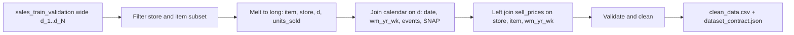

# Data and Machine Learning

Dataset handling and forecasting approach. Requirements: M-16 to M-18, M-20, M-24 in [project-specification.md](project-specification.md). Items marked **Proposed** are not yet confirmed ([decisions.md](decisions.md)).

## Dataset: M5 Forecasting - Accuracy (Walmart) (D-02)

| File | Content | Use |
|---|---|---|
| `sales_train_validation.csv` | Daily unit sales per item/store in wide columns `d_1`, `d_2`, ... | Target `units_sold` |
| `calendar.csv` | Date for each `d`, `wm_yr_wk`, events, SNAP flags | Date mapping, known future features |
| `sell_prices.csv` | Weekly price per `store_id`, `item_id`, `wm_yr_wk` | Price analysis (EDA) |

Data is downloaded manually from Kaggle after the usage terms are reviewed (T-04). Raw data and processed data are git-ignored and never committed. The dataset has no promotion, coupon or discount-percentage field; price changes are not treated as promotions.

Fields not guaranteed to exist must not be assumed: the first pipeline step is a read-only inspection of the real files (shape, date range, missing dates, price coverage, zero rate per item).

## Scope (M-18)

- One store (T-02, `CA_1` suggested) and 20-50 items (T-03).
- Selection rule is TBD and must be recorded in `dataset_contract.json`. Candidate criteria: complete history, limited share of zero-sales days, mix of departments. Intermittent items are a documented limitation.

## ETL: wide to long



Normalized fields (spec s5): `date, store_id, item_id, dept_id, cat_id, state_id, units_sold, sell_price, wm_yr_wk, event_name_1, event_type_1`, SNAP indicator. Missing prices are examined and handled per a documented null policy (T-13), never silently imputed. Validation rules for each field are in the table in [project-specification.md](project-specification.md) (section 5).

## Dataset contract (M-24)

`dataset_contract.json` records: schema version, source and dataset version, field names and types, key columns (`date`, `store_id`, `item_id`), ranges, allowed values, missing-value policy, assumptions, constraints, and the item/store subset rule. Crew 2 and Gate 1 validate against it. Format (JSON Schema or custom): TBD (T-12).

## Forecast target (D-03)

Daily `units_sold` for the next 28 days, per `item_id` x `store_id`.

## Chronological split (M-17)

```
|-------- train --------|-- validation (28d) --|-- test holdout (28d) --|
 d_1                                                          last day
```

- No random shuffling. The test window is the final 28 days of history and is never used for training or tuning.
- Provisional boundaries: test = last 28 days, validation = the 28 days before. Exact day indices: TBD after data inspection (T-09).

## Features (M-16, spec s8)

| Group | Features | Available at forecast time? |
|---|---|---|
| Calendar | Day of week, month, day of month | Yes |
| Events / SNAP | `event_name_1`, `event_type_1`, SNAP flag | Yes (calendar is known in advance) |
| Lags | Sales lags | Only lags at least as old as the horizon step |
| Rolling | Mean/std of past sales, past-only | Only windows ending before the forecast origin |
| Price | `sell_price` | Not reliably (future prices unknown) |

### Multi-step strategy (D-06, Proposed)

A 28-day horizon means a 7-day lag is unknown for days 8-28. Recommended approach: **direct forecasting with horizon-safe features.** Use only lags and rolling windows computed from data at least 28 days before each target date (for example lag 28, 35, 42 and rolling statistics shifted by 28), plus calendar and SNAP features. One model per variant, no recursive error accumulation, and every feature is available when the forecast is made. Stretch option: a recursive variant using 7/14-day lags with predicted values fed back (spec allows it); compare only if time permits.

### Price handling (D-07, Proposed)

The MVP model does not use `sell_price`, because future weekly prices are not known at forecast time. Price is analyzed descriptively in EDA. If a price variant is added later, it must state its assumption (for example, last known price held constant).

## Leakage prevention (M-17)

- A feature for date `t` uses only observations available at the forecast origin (data at least 28 days before `t` under D-06).
- Rolling features exclude the target day.
- Test observations are never used for fitting, feature selection or tuning.
- Unknown future prices are not assumed.
- Automated tests enforce these rules: see [testing-strategy.md](testing-strategy.md).

## Models and evaluation (D-04, D-05)

| Model | Role |
|---|---|
| Seasonal Naive | Baseline (repeat the value from one season earlier, weekly season of 7 days) |
| Ridge Regression | Variant 1 (Proposed) |
| Random Forest Regressor | Variant 2 (Proposed) |

- Metrics: MAE and RMSE on the same 28-day holdout, overall and per item. Seeds fixed.
- MAPE is avoided because intermittent items contain many zeros.
- Hyperparameters are tuned on the validation window only. Whether the final model is refit on train plus validation before the test forecast: TBD (T-16), must be documented either way.
- Outputs: `features.csv`, `model.joblib`, `evaluation_report.md`, `model_card.md` (M-04, M-06).

## Model card content (M-06)

Purpose, training data summary, metrics, limitations (intermittent demand, no inventory data, one store, no causal claims), ethical considerations (forecasts may drive staffing and stock decisions, single-store bias, no personal data).

## Reproducibility (M-20)

A run manifest stores: seeds, library versions, dataset version, selected items, split boundaries, assumptions and `run_id`. Deterministic steps must give identical results for the same inputs and seed.

## Optional: promotions analysis (O-03)

Descriptive comparison of weekly `sell_price` changes and `units_sold` by item and store, accounting for seasonality and events. No causal lift and no labeling of price changes as promotions. Any discount simulator (O-04) requires real price/discount data and is not part of the MVP.
