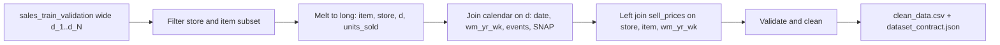

# Data and Machine Learning

Dataset handling and forecasting approach. Requirements: M-16 to M-18, M-20, M-24 in [project-specification.md](project-specification.md). Items marked **Proposed** are not yet confirmed ([decisions.md](decisions.md)).

## Dataset: M5 Forecasting - Accuracy (Walmart) (D-02)

| File | Content | Use |
|---|---|---|
| `sales_train_validation.csv` | Daily unit sales per item/store in wide columns `d_1`, `d_2`, ... | Target `units_sold` |
| `calendar.csv` | Date for each `d`, `wm_yr_wk`, events, SNAP flags | Date mapping, known future features |
| `sell_prices.csv` | Weekly price per `store_id`, `item_id`, `wm_yr_wk` | Price analysis (EDA) |

Data is downloaded manually from Kaggle, and only **after the usage terms have been checked (T-04, status: Pending verification)**. Raw and processed data are git-ignored and never committed; the repository holds only download instructions. Redistribution is not assumed to be allowed, so test fixtures are synthetic (M5-shaped), never real M5 rows.

**Terms check and download steps (T-04)**
1. Log in to Kaggle, open the *M5 Forecasting - Accuracy* competition, and read its **Rules** and **Data** pages (including the data license and any "accept rules" step).
2. Confirm that educational / coursework use is allowed and note any limit on redistribution or on publishing results.
3. Record the outcome in this section: date, who checked, link, conclusion. Until that is recorded, nobody downloads or uses the data.
4. Download the three files through the Kaggle website (or the Kaggle CLI with a personal token kept outside the repo; installing the CLI needs approval) and place them in a root `data/raw/` folder, which Git ignores.
5. Record the dataset version/date in `dataset_contract.json` and the run manifest.

Terms check result: *not yet recorded.* The dataset has no promotion, coupon or discount-percentage field; price changes are not treated as promotions.

Fields not guaranteed to exist must not be assumed: the first pipeline step is a read-only inspection of the real files (shape, date range, missing dates, price coverage, zero rate per item).

## Scope (M-18)

- One store: **`CA_1`** (T-02, Approved). The store id is a configuration value, so another store can be selected later; the MVP implements one store only.
- Items: start with **20**, with the option to expand to 50 using the same method (T-03, approach Approved; exact items pending inspection).
- Intermittent items are a documented limitation.

### Item selection method (T-03)

| Rule | Detail |
|---|---|
| Data used | Training period only. The validation window and the final 28-day test window are never used to pick items (boundaries: T-09) |
| Pool | All items sold in `CA_1` |
| Eligibility | Enough sales history in the training period; share of zero-sales days below a limit (extremely sparse items excluded); adequate weekly price coverage in training weeks. Numeric limits are set after the inspection |
| Demand levels | Split eligible items into high, medium and low by mean daily units in the training period; take about equal numbers from each (for 20 items, 7/7/6) |
| Choice within a level | Seeded random pick so the result is reproducible (seed recorded); department mix is a soft preference |
| Record | Method, thresholds, seed and the selected `item_id` values go into `dataset_contract.json` (`selection` block) and into the list below |
| Expansion | Going from 20 to 50 repeats the same method with a larger count and the same seed |

Selected `item_id` values: *pending dataset inspection.* Note: price coverage is used for selection and EDA even though `sell_price` is not a model feature (D-07), because the optional promotions analysis (O-03) and a possible price variant need it.

## ETL: wide to long



Normalized fields (spec s5): `date, store_id, item_id, dept_id, cat_id, state_id, units_sold, sell_price, wm_yr_wk, event_name_1, event_type_1`, SNAP indicator. Missing prices are examined and handled per a documented null policy (T-13), never silently imputed. Field validation rules are in the table in [project-specification.md](project-specification.md) (section 5).

## Dataset contract (M-24, T-12 Approved)

`dataset_contract.json` is a **versioned JSON file** written by the Business Analyst (Crew 1) and read by Gate 1, Crew 2 and the Flow. It describes the dataset so that data can be checked mechanically.

| Section | Content |
|---|---|
| `schema_version` | Contract version (for example `1.0.0`); changed whenever the structure changes |
| `dataset` | Name, source, files, download date, whether the terms check (T-04) was done |
| `granularity` | Keys `store_id`, `item_id`, `date`; daily frequency; one row per key combination |
| `selection` | Store, selected `item_id` list, selection method and seed (see above) |
| `fields` | For each field: name, type, nullable, allowed range or allowed values |
| `missing_value_rules` | What is allowed to be missing and how it is handled (for example prices, T-13) |
| `quality_expectations` | Limits such as maximum share of missing values, no duplicate keys, no gaps in dates |
| `validation_rules` | Named checks the validator runs (for example `units_sold >= 0`, `sell_price > 0 when present`) |
| `assumptions`, `limitations` | Plain-language lists (for example "no promotion flag in M5") |

Validation is **deterministic Python** (plain pandas checks, one function per rule, readable error messages) in `src/data/`. No schema-management framework is added. Gate 1 and the Feature Engineer both run it; a failure stops the Flow (M-08, M-19). The exact field list is finalized when the first clean data exists.

## Forecast target (D-03)

Daily `units_sold` for the next 28 days, per `item_id` x `store_id`.

## Chronological split (M-17)

```
|-------- train --------|-- validation (28d) --|-- test holdout (28d) --|
 d_1                                                          last day
```

- No random shuffling. The test window is the final 28 days of history and is never used for training or tuning.
- Provisional boundaries: test = last 28 days, validation = the 28 days before. Exact day indices: TBD after data inspection (T-09).

## Features (M-16, spec s8)

| Group | Features | Available at forecast time? |
|---|---|---|
| Calendar | Day of week, month, day of month | Yes |
| Events / SNAP | `event_name_1`, `event_type_1`, SNAP flag | Yes (calendar is known in advance) |
| Lags | Sales lags | Only lags at least as old as the horizon step |
| Rolling | Mean/std of past sales, past-only | Only windows ending before the forecast origin |
| Price | `sell_price` | Not reliably (future prices unknown) |

### Multi-step strategy (D-06, Proposed)

A 28-day horizon means a 7-day lag is unknown for days 8-28. Recommended approach: **direct forecasting with horizon-safe features.** Use only lags and rolling windows computed from data at least 28 days before each target date (for example lag 28, 35, 42 and rolling statistics shifted by 28), plus calendar and SNAP features. One model per variant, no recursive error accumulation, and every feature is available when the forecast is made. Stretch option: a recursive variant using 7/14-day lags with predicted values fed back (spec allows it); compare only if time permits.

### Price handling (D-07, Proposed)

The MVP model does not use `sell_price`, because future weekly prices are not known at forecast time. Price is analyzed descriptively in EDA. If a price variant is added later, it must state its assumption (for example, last known price held constant).

## Leakage prevention (M-17)

- A feature for date `t` uses only observations available at the forecast origin (data at least 28 days before `t` under D-06).
- Rolling features exclude the target day.
- Test observations are never used for fitting, feature selection or tuning.
- Unknown future prices are not assumed.
- Automated tests enforce these rules: see [testing-strategy.md](testing-strategy.md).

## Models and evaluation (D-04, D-05)

| Model | Role |
|---|---|
| Seasonal Naive | Baseline (repeat the value from one season earlier, weekly season of 7 days) |
| Ridge Regression | Variant 1 (Proposed) |
| Random Forest Regressor | Variant 2 (Proposed) |

- Metrics: MAE and RMSE on the same 28-day holdout, overall and per item. Seeds fixed.
- MAPE is avoided because intermittent items contain many zeros.
- Hyperparameters are tuned on the validation window only. Whether the final model is refit on train plus validation before the test forecast: TBD (T-16), must be documented either way.
- Outputs: `features.csv`, `model.joblib`, `evaluation_report.md`, `model_card.md` (M-04, M-06).

## Model card content (M-06)

Purpose, training data summary, metrics, limitations (intermittent demand, no inventory data, one store, no causal claims), ethical considerations (forecasts may drive staffing and stock decisions, single-store bias, no personal data).

## Reproducibility (M-20)

A run manifest stores: seeds, library versions, dataset version, selected items, split boundaries, assumptions and `run_id`. Deterministic steps must give identical results for the same inputs and seed.

## Optional: promotions analysis (O-03)

Descriptive comparison of weekly `sell_price` changes and `units_sold` by item and store, accounting for seasonality and events. No causal lift and no labeling of price changes as promotions. Any discount simulator (O-04) requires real price/discount data and is not part of the MVP.
