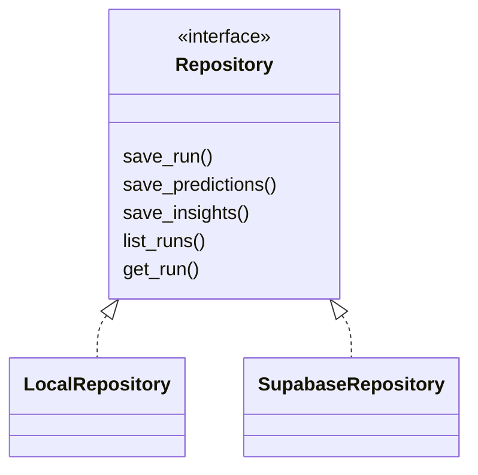
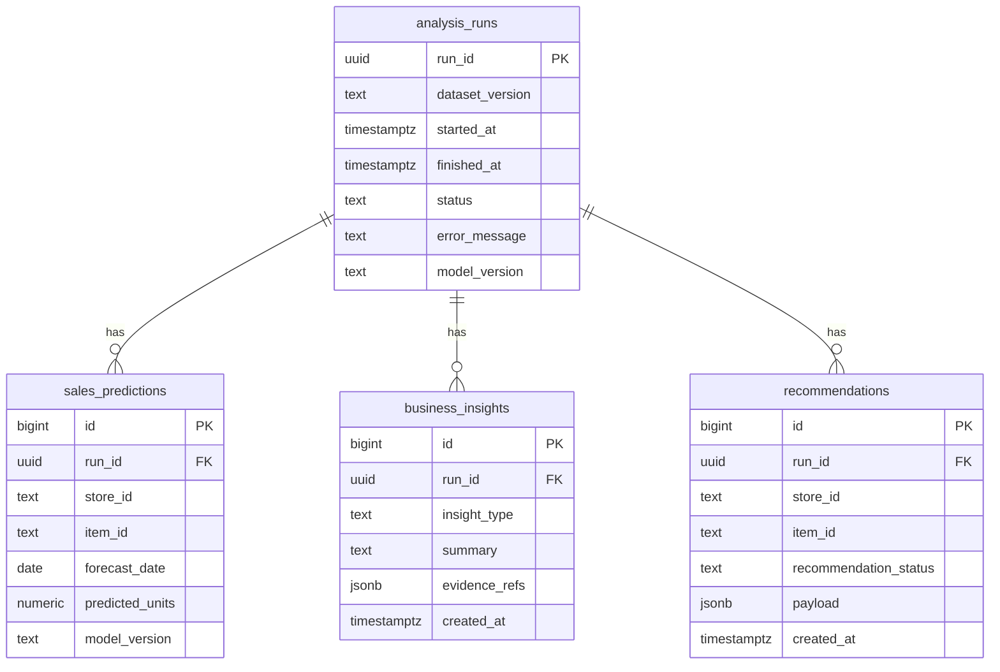

# Database Design

Planned, optional persistence layer (O-02, Supabase connection Deferred, D-15). The pipeline must work fully with the local backend alone (D-08). Requirements: section 10A of [project-specification.md](project-specification.md).

## Repository abstraction

- The five methods come from the spec. A method for storing recommendations is needed if D-10 is approved (Proposed: `save_recommendation`).
- Backend selected by `REPOSITORY_BACKEND=local|supabase`, default `local`.
- Crews, ML code and Streamlit pages use only the interface. Only `SupabaseRepository` imports the Supabase client.
- `LocalRepository` is backed by SQLite (Proposed, D-11) so queries behave like Postgres; JSON files are the alternative.
- Both backends must pass the same contract tests ([testing-strategy.md](testing-strategy.md)).

## Schema (Proposed)

Corrected to the product-level M5 design: `store_id` and `item_id` replace `store_nbr` and `family` from the Word spec (D-09, see the corrections section of [project-specification.md](project-specification.md)).

| Table | Columns and constraints |
|---|---|
| `analysis_runs` | `run_id` PK; `dataset_version`, `started_at` NOT NULL; `finished_at`, `error_message`, `model_version` nullable; `status` NOT NULL with a CHECK on allowed values (see state names in [architecture.md](architecture.md)) |
| `sales_predictions` | `id` PK; `run_id` FK to `analysis_runs` (ON DELETE CASCADE); `store_id`, `item_id`, `forecast_date`, `model_version` NOT NULL; `predicted_units >= 0`; UNIQUE (`run_id`, `store_id`, `item_id`, `forecast_date`, `model_version`) |
| `business_insights` | `id` PK; `run_id` FK; `insight_type`, `summary` NOT NULL; `evidence_refs` JSON; `created_at` default now; UNIQUE (`run_id`, `insight_type`) for idempotent retries (exact key TBD, T-18) |
| `recommendations` (Proposed) | `id` PK; `run_id` FK; `store_id`, `item_id` nullable; `recommendation_status` NOT NULL; `payload` JSON holding the full `recommendation.json`; UNIQUE (`run_id`, `store_id`, `item_id`) |

Column name `predicted_units` replaces the spec's `predicted_sales` to match the `units_sold` target; this rename is Proposed.

### Recommendations: separate table or `business_insights`? (D-10)

| Option | Pros | Cons |
|---|---|---|
| Separate `recommendations` table (Proposed) | Strict fields (status, evidence, forecast reference); simple queries and validation; different lifecycle from insights | One more table and migration |
| Rows in `business_insights` with `insight_type = 'recommendation'` | No extra table; matches the spec's three-table schema | Loose JSON; harder to validate and query by status |

Fallback if time is short: use `business_insights` and migrate later.

## Idempotent writes

- One `run_id` per Flow run, created once and reused on retry.
- Writes are upserts keyed on the UNIQUE constraints above, so a retry never creates duplicates.
- Multi-row writes (28 days x N items) run as one batch/transaction per run.

## Error handling and local fallback

- Local files in `artifacts/` are always written first; the eight mandatory artifacts never depend on a database.
- A Supabase failure is logged, shown clearly in the UI, marks the run `COMPLETED_WITH_WARNINGS`, and keeps local outputs. A configured fallback policy decides whether to queue unsent records for retry (TBD, T-17).
- Secrets never appear in logs (a test checks this).

## Configuration and security

- `SUPABASE_URL` and a least-privilege key come from `.env` or deployment secrets; `.env.example` lists names only.
- The `service_role` key is never exposed to client-side or Streamlit browser code. Row Level Security is enabled as appropriate.
- Whether each developer uses their own project or a shared one: TBD (T-05).

## Migrations

Plain SQL files (folder TBD, T-20; numbered, forward-only), applied manually or with the Supabase CLI. Created only when D-15 starts (week 3 or later). The local SQLite schema mirrors the same tables.

## Out of scope

Migrating the full M5 dataset to Postgres, user authentication, hosted vector storage (pgvector is a possible future extension, not required).
