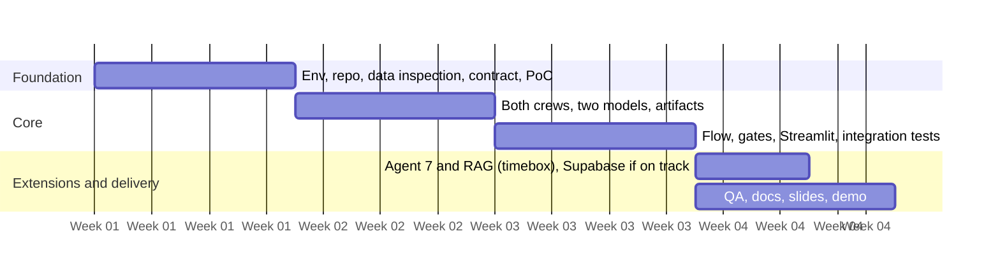
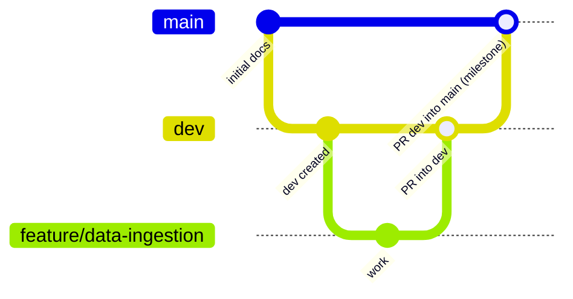

# Implementation Plan

Four weeks, two developers. Schedule source: section 16 of [project-specification.md](project-specification.md). Ownership follows T-11 (see [agents-and-tasks.md](agents-and-tasks.md)): Developer A does data and Crew 1, Developer B does ML and Crew 2, and the Flow, Agent 7, RAG, Supabase, end-to-end testing and the presentation are shared. Who is A and who is B is still pending (T-11). Open choices: [decisions.md](decisions.md).

**Priority order:** 1. mandatory academic requirements, 2. working end-to-end forecasting, 3. Agent 7 and RAG, 4. Supabase, 5. optional improvements. **MVP milestone:** end of week 3, a local end-to-end run (both crews, both gates, Streamlit) with no RAG and no Supabase.



Dates in the chart are placeholders only; actual start date is TBD (T-19).

## Week 1: foundation

| | |
|---|---|
| Objective | Repository and environment ready; data inspected; baseline works |
| Dev A | Check the Kaggle M5 terms and record the result (T-04), then download; inspect files, ETL wide-to-long, select the 20 `CA_1` items by the T-03 method, draft the JSON contract (T-12), start Crew 1 tools, create the synthetic test fixture |
| Dev B | Feature and baseline PoC (Seasonal Naive plus Ridge) on the fixture first, then on real data once T-04 is done; `Repository` interface and `LocalRepository` |
| Both | Confirm who is A and B (T-11); settings module for OpenAI configuration with no calls yet; set the OpenAI spend limit; verify the model with one approved call (T-01); freeze the interfaces in [agents-and-tasks.md](agents-and-tasks.md); settle T-09 |
| Deliverables | Clean long-format data, draft contract, working baseline, repo with CI skeleton |
| Exit | Clean data and a working baseline |
| Effort | About 12-15 h per developer |

## Week 2: crews and models

| | |
|---|---|
| Objective | Both crews work independently and produce all eight artifacts |
| Dev A | Crew 1 agents and tasks, `eda_report.html`, `insights.md`, `dataset_contract.json` |
| Dev B | Crew 2 agents and tasks, Ridge and Random Forest, per-item MAE/RMSE, `model_card.md` |
| Dependency | Dev B consumes the contract and `clean_data.csv` format agreed in week 1 |
| Exit | Each crew runs on its own and writes its artifacts |

## Week 3: Flow, UI, integration (MVP gate)

| | |
|---|---|
| Objective | End-to-end execution with validation and graceful failure |
| Dev A | Data Streamlit screens (Home, Data Quality, EDA, Insights) |
| Dev B | Forecasting Streamlit screens (Forecast, Model Evaluation) |
| Shared | CrewAI Flow, Gate 1 and Gate 2, logging, Run History screen, Flow integration and end-to-end tests |
| Then (shared) | Agent 7 and RAG in a 4-6 h timebox (D-16) if the MVP gate is met; Supabase only after that (D-15) |
| Exit | One command runs the full local pipeline and the UI shows its results |

## Week 4: QA and delivery

| | |
|---|---|
| Objective | Stable submission package |
| Tasks | Bug fixes, end-to-end and failure tests, README setup and reproduction check on a clean machine, 10-12 slide presentation (shared), demo video of at most 5 minutes (M-14), decision on committing final artifacts (T-07) |
| Optional | Supabase adapter and migrations; deployment (D-17) |
| Exit | Submission package complete; each developer has a documented merged PR (M-12) |

## What can run in parallel

- ETL and contract (A) with features and models (B), once the contract and `clean_data.csv` format are frozen.
- Streamlit pages (A/B) with Flow work, once artifact formats are frozen.
- Repository interface (week 1) with everything else.
- Everything crossing between A and B goes through the frozen interfaces in [agents-and-tasks.md](agents-and-tasks.md), so neither waits for the other's code.

**If late, cut in this order:** Supabase, then Agent 7/RAG, then promotions analysis. Never cut the mandatory Flow, artifacts or forecasts.

## Working with Claude Code

One focused task at a time, each ending in a reviewed pull request:

1. State the task, the files involved, and the expected output.
2. Write or update tests first, then the code.
3. Run tests locally; both developers can explain the diff.
4. Run a code review, then merge via PR before starting the next task.

Suggested task order: environment and scaffold, config and logging, data inspection, ETL and validation, contract, features with leakage tests, models and evaluation, tool wrappers, Crew 1, Crew 2, Flow and gates, LocalRepository, Streamlit pages, then the optional parts. Do not generate the whole application in one step. Conventions: [../CLAUDE.md](../CLAUDE.md).

## Git workflow (D-18, D-19, D-23)



- `main`: production, default branch, PR from `dev` only. `dev`: integration; every feature branch starts here.
- Steps: 1. branch from `dev`; 2. implement and test; 3. update `docs/progress.md`; 4. PR into `dev`; 5. review and validate; 6. merge; 7. at a stable milestone PR `dev` into `main`; 8. merge after final validation and approval.
- **Branch names:** `feature/data-ingestion`, `feature/analyst-crew`, `feature/ml-forecasting`, `feature/rag-recommendations`, `feature/supabase-integration`, `docs/update-architecture`. Small focused commits; PR descriptions say what changed, how it was tested and which `docs/progress.md` rows were updated.
- Repository `retailai-multi-agent-sales-intelligence`; its visibility and branch protection are managed by the repo owner. No automatic deployments and no separate Supabase environments yet.
- Branch protection (pending approval): PRs required for `main` and `dev`, one approving review, no force pushes, no branch deletion. On a two-person team the PR author cannot approve their own PR, so the other developer must be a collaborator (T-06).

**Second developer (after being invited, T-06):**
```
git clone https://github.com/micgotler-cmd/retailai-multi-agent-sales-intelligence.git
cd retailai-multi-agent-sales-intelligence
git checkout dev && git pull
git checkout -b feature/<task>      # work, commit, then:
git push -u origin feature/<task>   # open a Pull Request into dev
```
Copy `.env.example` to `.env` locally and fill in your own keys; never commit `.env`.

## Recommended first implementation task

A read-only dataset inspection script that reports shape, date range, missing dates, price coverage and zero rate per item, and proposes the store and item subset. This validates feasibility before any crew is written (informs T-03 and T-09); it runs only after the Kaggle terms check (T-04) is recorded.
