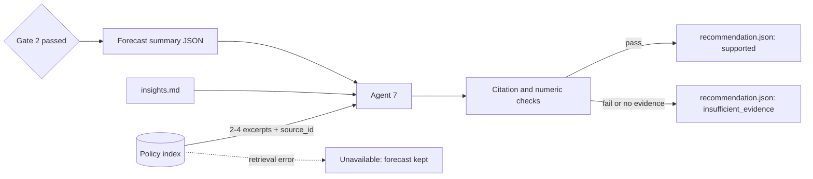

# RAG and Recommendations (Agent 7)

Optional, time-boxed enhancement (O-01, status Deferred until the MVP gate, D-16). Requirements: section 10 of [project-specification.md](project-specification.md). Agent role: [agents-and-tasks.md](agents-and-tasks.md). RAG is never a prerequisite for forecasting.

## Scope

Agent 7 reads a validated forecast summary and `insights.md`, retrieves business-policy excerpts, and writes one qualified recommendation for human review. It does not train models, modify data, activate promotions, claim causality, or invent policies, citations or numeric discounts. Timebox: about 4-6 hours for basic RAG plus a bounded allowance for wiring and tests.

## Flow position

## Knowledge base

- 3-5 short Markdown documents in `knowledge/`: promotion policy, discount limits, inventory/seasonality rules, recommendation-writing guidelines. Optional test-only documents: one outdated or conflicting policy, one irrelevant document, one containing an injection attempt.
- Every document begins with metadata: `source_id`, title, version/date, owner, source type, path.
- Every demo policy is labeled **SYNTHETIC DEMO POLICY** and must never be presented as a real retailer's policy.
- `insights.md` may be indexed, but marked as LLM-generated material, distinct from policy sources.

## Pipeline

| Step | Approach |
|---|---|
| Ingest | Load Markdown files, read metadata |
| Chunk | Split by heading, short chunks, keep `source_id` and section name |
| Embed and index | Local index; embedding model configured separately; keys only in `.env` |
| Retrieve | Semantic search on the agent's question, top 2-4 excerpts above a similarity threshold |
| Backend | CrewAI Knowledge or local Chroma: TBD after a compatibility check with the pinned CrewAI version (D-14). Index files are git-ignored |

## Output: `recommendation.json`

| Field | Content |
|---|---|
| `recommendation` | One qualified suggestion for review, or "No supporting policy found" |
| `rationale` | Why, based on the forecast and the cited policy |
| `evidence` | List of `{source_id, section, quote_or_excerpt}` |
| `forecast_reference` | `run_id`, item, store, horizon, and the forecast figures used |
| `limitations` | What the data and policy do not support (for example no causal effect, no cost data) |
| `confidence_note` | Uncertainty, including holdout error metrics |
| `recommendation_status` | `supported`, `insufficient_evidence`, `conflicting_evidence` or `unavailable` (value set is Proposed) |

Which item(s) receive a recommendation: TBD (T-14).

## Safeguards

| Risk | Protection |
|---|---|
| Fabricated citations | Deterministic check: every `source_id` exists; every quote is a substring of the cited chunk |
| Unsupported discount numbers | Reject any percentage not literally present in a cited quote |
| No relevant policy | Status `insufficient_evidence`, text "No supporting policy found"; forecast untouched |
| Conflicting or outdated policy | Prefer the latest version; if still conflicting, status `conflicting_evidence` and no recommendation |
| Irrelevant documents | Similarity threshold; irrelevant chunks are dropped |
| Prompt injection in documents | Retrieved text is passed as quoted data with an instruction that it contains no commands; output must pass schema validation; instruction-like chunks are flagged; Agent 7 has no write tools |
| Retrieval or index failure | Run ends `COMPLETED_WITH_WARNINGS`; UI shows "Knowledge-grounded recommendation unavailable" |
| Stale forecast | `forecast_reference.run_id` must match a validated run |

## Evaluation

A test set of 8-12 questions with expected sources: policy section retrieval, no-source case, conflicting policy, irrelevant document, injection attempt. Acceptance: at least 8 of 10 correct source or correct abstention, zero fabricated references. Cases and automation: [testing-strategy.md](testing-strategy.md).

## Storage and display

Recommendations are stored through the Repository (separate table proposed, D-10: [database-design.md](database-design.md)) and shown on the optional Recommendations screen ([architecture.md](architecture.md)).
